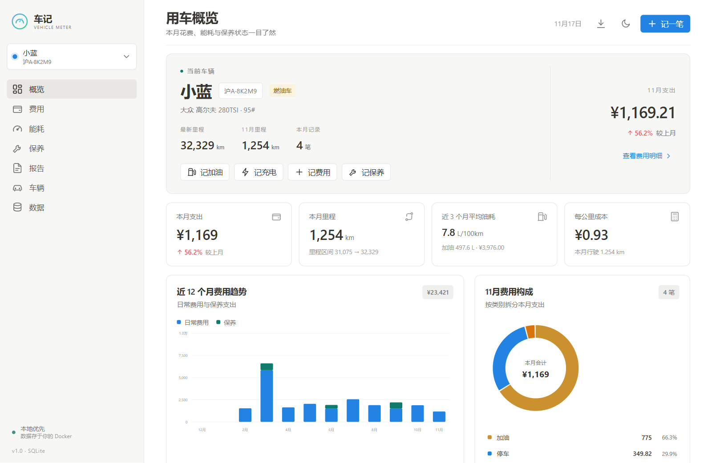
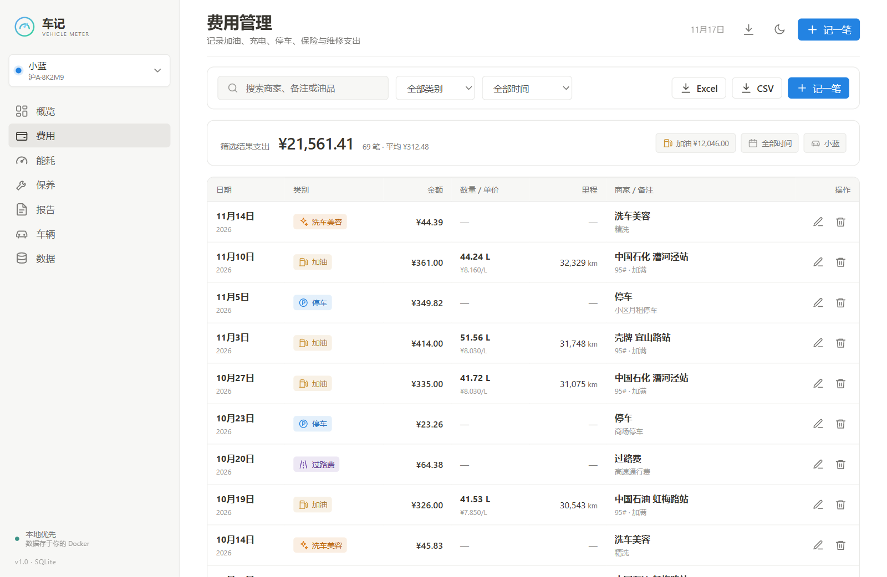
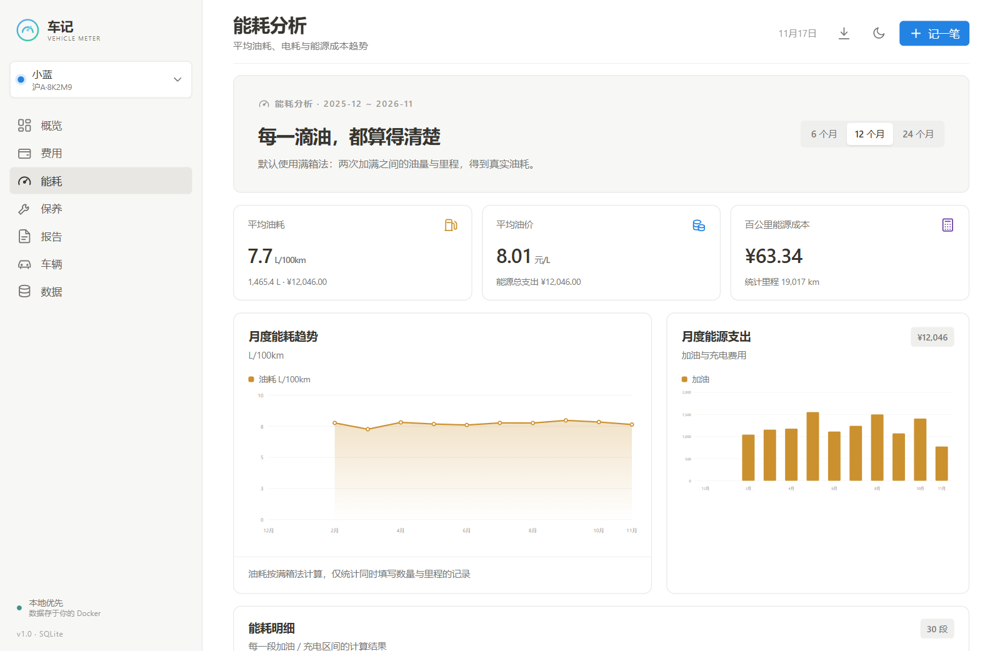
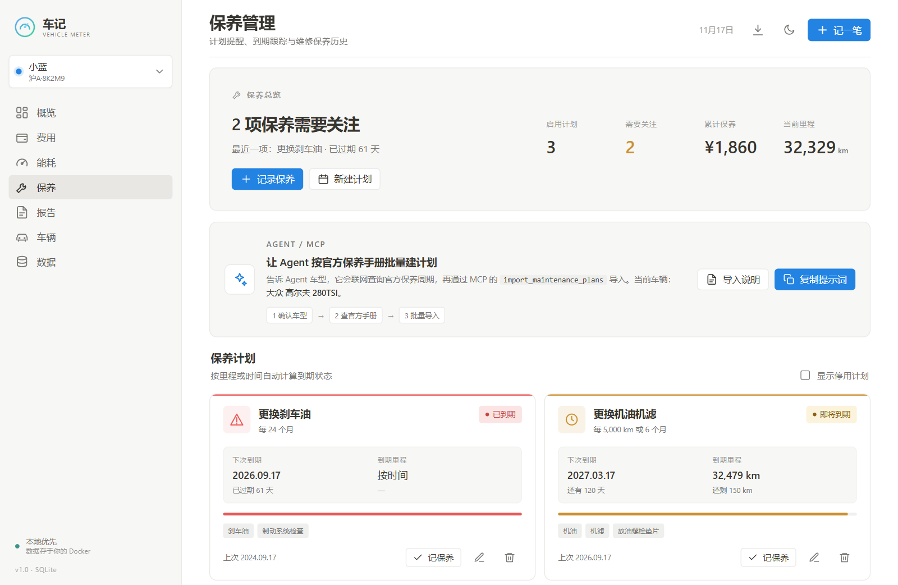
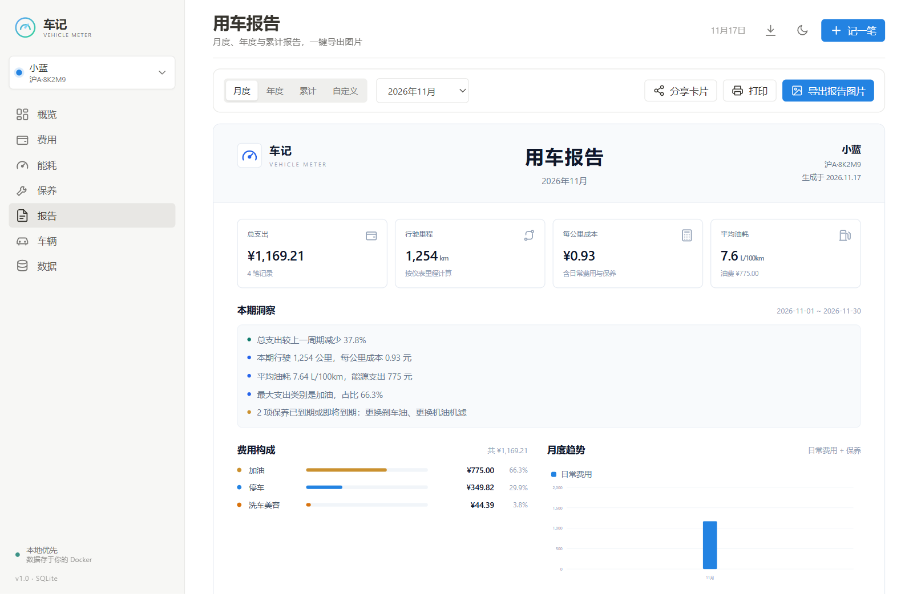
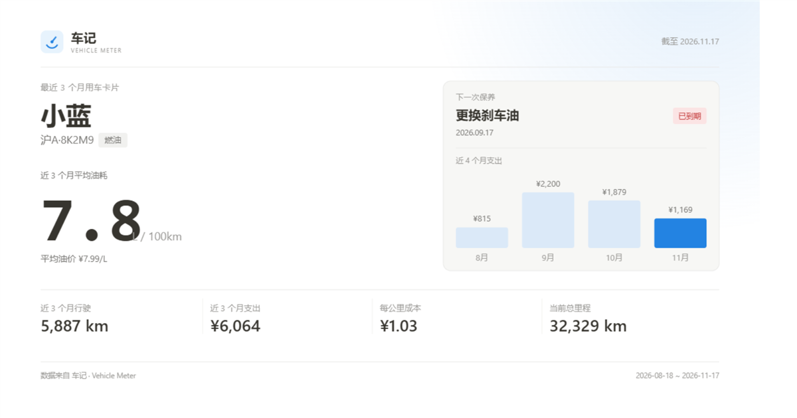

# Vehicle Meter · 车记

[中文](README.md) · [English](README.en.md) · [Français](README.fr.md) · **Español**

Una aplicación de gestión de vehículos con enfoque local. Un contenedor Docker y un archivo SQLite para gastos, energía, mantenimiento, informes, varios vehículos, copia de seguridad WebDAV e instalación PWA.

La interfaz se inspira en Notion: barra lateral gris claro, fondo blanco, bordes finos y tipografía sobria.

## Capturas de pantalla

| Panel | Gastos |
| --- | --- |
|  |  |

| Energía | Mantenimiento |
| --- | --- |
|  |  |

| Informes | Tarjeta 1200×630 |
| --- | --- |
|  |  |

## Funciones

- **Gastos**: combustible, carga, aparcamiento, peajes, seguro, reparaciones, lavado y otros; desglose por categoría, tendencia mensual y coste por kilómetro.
- **Análisis energético**: consumo de combustible por el método de depósito lleno, consumo eléctrico entre cargas, precio unitario de la energía y coste energético por 100 km.
- **Mantenimiento**: intervalos por kilómetros y por meses, avisos de vencimiento, historial y enlaces a la fuente oficial.
- **Informes**: mensual, anual, acumulado y personalizado; exportación PNG de alta resolución; tarjeta para compartir con un toque (Twitter / X 1200×630).
- **Varios vehículos**: gastos, energía, mantenimiento e informes independientes por vehículo.
- **Datos**: Excel, CSV (ZIP), copia de seguridad / restauración JSON completa y sincronización WebDAV (Jianguoyun, Nextcloud, Synology, etc.).
- **PWA**: instalar en la pantalla de inicio del móvil o en el escritorio, ejecución a pantalla completa y shell offline con Service Worker.
- **Integración con Agent**:
  - API de gastos estructurados (el Agent lee el recibo y envía JSON; el backend no hace OCR de imágenes).
  - **Importación masiva de planes de mantenimiento por MCP**: indica el modelo al Agent, consulta el plan oficial de mantenimiento e importa los planes mediante MCP.

## Tecnologías

| Capa | Elección |
| --- | --- |
| Runtime | Node.js ≥ 22.13 (Node 24 Alpine en Docker) |
| Backend | `http` nativo + `node:sqlite` integrado, sin dependencias de ejecución |
| Base de datos | SQLite (WAL, creación y migraciones automáticas del esquema) |
| Frontend | ES Modules nativos + gráficos SVG dibujados a mano + tarjetas Canvas, sin paso de compilación |
| Despliegue | Docker / Docker Compose de un solo contenedor |
| Integraciones | API REST, servidor MCP stdio, PWA, WebDAV |

> Sin Vue / React / bundler. El objetivo es un solo contenedor, sin compilación y con pocas dependencias. Se puede reconsiderar un framework frontend y PostgreSQL si alguna vez se necesita colaboración multiusuario a gran escala.

## Inicio rápido

### Docker Compose (recomendado)

```bash
docker compose up -d --build
```

Abre <http://localhost:8080>.

Los datos se guardan en el volumen nombrado `vehicle-meter-data`:

```bash
docker compose logs -f
docker compose down          # detener, los datos se conservan
```

`.env` opcional:

```dotenv
PORT=8080
APP_PASSWORD=tu-contraseña   # vacío desactiva la autenticación
TZ=Asia/Shanghai
```

Si se define `APP_PASSWORD`, el navegador mostrará autenticación HTTP Basic.

### Publicar en GitHub / GHCR

El workflow `.github/workflows/publish-ghcr.yml` usa el `GITHUB_TOKEN` integrado y no necesita secretos adicionales. Compila imágenes `linux/amd64` y `linux/arm64` en cada push a `main` y en etiquetas `v*.*.*`.

```bash
git tag v1.0.0
git push origin v1.0.0
```

Imágenes:

```text
ghcr.io/<usuario-github>/vehicle-meter:latest
ghcr.io/<usuario-github>/vehicle-meter:main
ghcr.io/<usuario-github>/vehicle-meter:1.0.0
ghcr.io/<usuario-github>/vehicle-meter:sha-xxxxxxx
```

Para paquetes privados:

```bash
echo "$GITHUB_TOKEN" | docker login ghcr.io -u <usuario-github> --password-stdin
```

Ejecutar desde la imagen:

```yaml
services:
  vehicle-meter:
    image: ghcr.io/<usuario-github>/vehicle-meter:latest
    container_name: vehicle-meter
    restart: unless-stopped
    ports:
      - "8080:8080"
    environment:
      TZ: Asia/Shanghai
      APP_PASSWORD: ${APP_PASSWORD:-}
    volumes:
      - vehicle-meter-data:/data
volumes:
  vehicle-meter-data:
```

### Desarrollo local

Se requiere Node.js ≥ 22.13 (por `node:sqlite`):

```bash
node --version
npm start
```

No hace falta `npm install`: el proyecto no tiene dependencias de ejecución. La app se abre en <http://localhost:8080> y la base de datos está en `data/vehicle-meter.sqlite`.

```bash
npm test                     # pruebas de API / importación / copia / MCP / PWA
node test/api.test.js        # lo mismo, útil en entornos restringidos
```

### Primer uso

1. Añade un vehículo (nombre, modelo, tipo de energía, odómetro inicial).
2. Registra el primer gasto de combustible / carga / aparcamiento y crea un plan de mantenimiento.
3. En **Informes**, elige un mes o año y exporta un PNG o una tarjeta para compartir.
4. En **Datos**, configura WebDAV o exporta una copia de seguridad completa.

Si no hay datos, pulsa **Cargar datos de ejemplo**.

## Agent / MCP: importar el plan oficial de mantenimiento

### Flujo

1. El usuario indica el modelo al Agent, por ejemplo «mi coche es un Volkswagen Golf 280TSI de 2023».
2. El Agent llama a `list_vehicles` para confirmar el vehículo y el modelo / año en Vehicle Meter.
3. El Agent busca el plan oficial de mantenimiento del fabricante (o una página proporcionada por el usuario).
4. El Agent prepara el JSON de planes, hace un `dryRun` y después llama a `import_maintenance_plans`.
5. Vehicle Meter hace upsert por `externalId` (o por nombre), guarda `sourceUrl` y muestra **Fuente oficial** en la tarjeta del plan.

> El Agent debe aportar una fuente real y no inventar intervalos. Los planes oficiales son solo una referencia; el mantenimiento real depende del estado del vehículo, de los requisitos actuales del fabricante y de la revisión en el taller.

### Iniciar el servidor MCP

El servidor MCP es un proceso stdio JSON-RPC sin dependencias que llama a la aplicación por HTTP.

**Host (Node)**

```json
{
  "mcpServers": {
    "vehicle-meter": {
      "command": "node",
      "args": ["/ruta/absoluta/a/vehicle-meter/mcp/server.js"],
      "env": {
        "VEHICLE_METER_URL": "http://127.0.0.1:8080",
        "VEHICLE_METER_PASSWORD": ""
      }
    }
  }
}
```

**Dentro de Docker**

```json
{
  "mcpServers": {
    "vehicle-meter": {
      "command": "docker",
      "args": ["exec", "-i", "vehicle-meter", "node", "/app/mcp/server.js"]
    }
  }
}
```

`docker-compose.yml` también inyecta `APP_PASSWORD` como `VEHICLE_METER_PASSWORD`, por lo que el MCP dentro del contenedor se autentica automáticamente.

Herramientas:

| Herramienta | Función |
| --- | --- |
| `list_vehicles` | Lista vehículos con modelo, año, odómetro actual y próximo mantenimiento |
| `get_maintenance_plans` | Lee los planes existentes y su vencimiento |
| `import_maintenance_plans` | Importación masiva con `dryRun`, `deactivateMissing`, `sourceUrl` |
| `create_vehicle` | Crea el vehículo si aún no existe |

### Llamada directa a la API HTTP

```bash
curl -X POST http://localhost:8080/api/agent/maintenance-plans \
  -H "Content-Type: application/json" \
  -d '{
    "vehiclePlate": "沪A·8K2M9",
    "source": "official",
    "sourceUrl": "https://www.vw.com.cn/",
    "dryRun": false,
    "items": [
      {
        "name": "更换机油机滤",
        "intervalMileage": 10000,
        "intervalMonths": 12,
        "items": "机油, 机滤",
        "notes": "Plan oficial: cada 10.000 km o 12 meses",
        "externalId": "vw-golf-oil-filter"
      },
      {
        "name": "更换刹车油",
        "intervalMonths": 24,
        "items": "刹车油",
        "externalId": "vw-golf-brake-fluid"
      }
    ]
  }'
```

Esquema completo y ejemplo:

```bash
curl http://localhost:8080/api/agent/maintenance-schema
```

### Idempotencia

- `externalId` es único por vehículo; volver a importar actualiza el plan existente.
- Sin `externalId`, los planes se emparejan por nombre.
- Un plan nuevo sin datos de mantenimiento previos calcula su próximo vencimiento desde el odómetro / la fecha actuales, para que una importación reciente no marque todo en rojo de inmediato.
- `deactivateMissing: true` desactiva los planes no manuales del vehículo que no aparezcan en esta importación; útil para una actualización completa.

### Entrada de gastos del Agent (sin OCR de imágenes)

El reconocimiento de imágenes lo hace el Agent; Vehicle Meter solo recibe JSON estructurado:

```bash
curl -X POST http://localhost:8080/api/agent/expenses \
  -H "Content-Type: application/json" \
  -d '{
    "vehiclePlate": "沪A·8K2M9",
    "category": "fuel",
    "date": "2026-11-17",
    "amount": 320.5,
    "quantity": 40.06,
    "unitPrice": 8.0,
    "odometer": 32380,
    "station": "Sinopec Caohejing",
    "fuelType": "95#",
    "fullTank": true,
    "externalId": "agent-20261117-001"
  }'
```

`GET /api/agent/schema` devuelve la descripción de campos y el JSON Schema. El importe es obligatorio; con dos de cantidad, precio unitario e importe se deduce el tercero.

## PWA: instalar en móvil / escritorio

- Se incluyen `manifest.webmanifest`, iconos PNG 192/512, Apple Touch Icon y Service Worker.
- Android Chrome / Edge: icono de instalación en la barra de direcciones o menú → **Instalar aplicación**.
- iPhone / iPad: Safari → Compartir → **Añadir a pantalla de inicio**.
- Chrome / Edge de escritorio: icono de instalación a la derecha de la barra de direcciones.

**Requisito HTTPS**: los Service Workers y la instalación PWA de Chrome requieren un contexto seguro. Al acceder a `http://192.168.x.x:8080` desde el móvil, la instalación en Android y la caché offline normalmente no funcionan. En producción, coloca un proxy inverso HTTPS (Caddy / Nginx / Traefik) delante del contenedor. En iOS, **Añadir a pantalla de inicio** puede funcionar primero por HTTP.

La entrada de instalación está en **Datos y ajustes → Instalar en móvil / escritorio**; también aparece un icono de descarga en la barra superior cuando la instalación está disponible.

## Datos, exportación y copia de seguridad

| Función | Ubicación | Detalles |
| --- | --- | --- |
| Excel | Gastos / Datos | Vehículos, gastos, mantenimientos, planes y resumen mensual |
| CSV | Gastos / Datos | BOM UTF-8; «Todo» exporta un ZIP |
| Copia completa | Datos | JSON con vehículos, gastos, planes, registros y ajustes (incluida la contraseña WebDAV) |
| Restauración | Datos | Reemplaza todos los datos actuales y conserva los ID |
| WebDAV | Datos | Jianguoyun, Nextcloud, Synology; probar, copiar y restaurar desde remoto |

**Jianguoyun**: crea una contraseña de aplicación en **Cuenta → Seguridad**, usa `https://dav.jianguoyun.com/dav/` y esa contraseña, no la de inicio de sesión.

> Una copia completa contiene ajustes sensibles como la contraseña WebDAV; no la compartas. La contraseña WebDAV se guarda en texto plano en SQLite, una decisión deliberada para una app autoalojada de un solo usuario.

## Configuración

| Variable | Valor por defecto | Descripción |
| --- | --- | --- |
| `PORT` | `8080` | Puerto de escucha |
| `HOST` | `0.0.0.0` | Dirección de escucha |
| `DATA_DIR` | `./data` | Directorio de datos (`/data` en Docker) |
| `DB_PATH` | `$DATA_DIR/vehicle-meter.sqlite` | Archivo SQLite |
| `APP_PASSWORD` | vacío | Activa autenticación HTTP Basic |
| `TZ` | zona del sistema | Afecta a «hoy» y a las estadísticas mensuales; Compose usa `Asia/Shanghai` |
| `MAX_BODY_BYTES` | `31457280` | Límite del cuerpo JSON |
| `LOG_REQUESTS` | desactivado | `1` para registrar peticiones |

## Resumen de la API

| Método | Ruta | Descripción |
| --- | --- | --- |
| GET | `/api/health` | Comprobación de salud (sin autenticación) |
| GET | `/api/bootstrap` | Vehículos, ajustes, categorías y contadores |
| GET/POST | `/api/vehicles` | Listar / crear vehículos |
| PUT/DELETE | `/api/vehicles/:id` | Actualizar / archivar (`?hard=1` para borrar) |
| GET/POST | `/api/expenses` | Listar / crear gastos |
| PUT/DELETE | `/api/expenses/:id` | Actualizar / eliminar |
| GET/POST | `/api/plans` | Planes con vencimiento / crear |
| PUT/DELETE | `/api/plans/:id` | Actualizar / eliminar |
| GET/POST | `/api/maintenance` | Historial de mantenimiento / crear |
| GET | `/api/stats/dashboard` | Estadísticas del panel |
| GET | `/api/stats/energy` | Estadísticas energéticas |
| GET | `/api/reports` | Informe mensual / anual / acumulado / personalizado |
| GET | `/api/card` | Datos de la tarjeta (últimos 3 meses por defecto) |
| POST | `/api/agent/expenses` | Entrada de gastos del Agent (idempotente) |
| POST | `/api/agent/maintenance-plans` | Importación masiva de planes del Agent |
| GET | `/api/agent/schema` | Esquema de gastos |
| GET | `/api/agent/maintenance-schema` | Esquema de importación de planes |
| GET | `/api/export/xlsx` | Exportación Excel |
| GET | `/api/export/csv?kind=all` | Exportación CSV / ZIP |
| GET/POST | `/api/backup`, `/api/restore` | Copia / restauración completa |
| GET/PUT | `/api/settings` | Ajustes (la contraseña WebDAV nunca se devuelve) |
| POST | `/api/webdav/test`, `backup`, `restore` | Acciones WebDAV |

## Estructura del proyecto

```text
.
├── server.js               # servidor HTTP, archivos estáticos, autenticación
├── src/
│   ├── api.js              # rutas REST, entrada Agent, import/export
│   ├── db.js               # esquema SQLite / migraciones
│   ├── stats.js            # combustible, energía, informes, tarjeta
│   ├── xlsx.js             # generación XLSX / ZIP nativa
│   ├── webdav.js           # cliente WebDAV
│   ├── demo.js             # datos de ejemplo
│   └── util.js             # fechas, validación, CSV
├── mcp/server.js           # servidor MCP stdio (sin dependencias)
├── public/
│   ├── index.html
│   ├── css/app.css         # diseño y responsive
│   ├── css/notion.css      # estilo inspirado en Notion
│   ├── js/                 # SPA, gráficos, tarjetas Canvas, PWA
│   ├── icons/              # iconos PWA
│   ├── manifest.webmanifest
│   └── sw.js               # Service Worker
├── scripts/make-icons.mjs  # regenerar iconos PWA
├── test/api.test.js
├── Dockerfile
└── docker-compose.yml
```

## Reglas de cálculo

- **Consumo de combustible**: método de depósito lleno por defecto. Combustible entre dos llenados ÷ diferencia de odómetro × 100, en L/100 km.
- **Consumo eléctrico**: entre dos cargas, energía cargada ÷ distancia × 100, en kWh/100 km.
- **Kilometraje**: lecturas de odómetro de gastos y mantenimientos más el odómetro inicial; se usa la lectura más cercana cuando un extremo no tiene lectura.
- **Coste**: gastos corrientes + costes de mantenimiento; coste por km = coste total ÷ distancia del periodo.
- **Vencimiento de mantenimiento**: prevalece un vencimiento explícito; si no, última revisión / fecha de compra + intervalo. El umbral de aviso es de 30 días / 500 km por defecto.
- **Tarjeta para compartir**: consumo medio de los últimos 3 meses, kilometraje, gasto total, coste por km, odómetro actual, próximo mantenimiento y gastos de los últimos 4 meses.

## Seguridad y limitaciones

- Diseño de un solo usuario y una sola instancia. SQLite sirve para datos personales / familiares, no para escrituras concurrentes de varias instancias.
- Sin inicio de sesión por defecto. Define siempre `APP_PASSWORD` y HTTPS si se expone a Internet.
- Sin TLS integrado. Usa Caddy / Nginx / Traefik como proxy inverso.
- La contraseña WebDAV se guarda en texto plano en SQLite y se incluye en las copias completas.
- Los datos oficiales de mantenimiento los obtiene y escribe el Agent; la app no incluye manuales de fabricantes ni garantiza la exactitud de datos de terceros.
- El reconocimiento de imágenes no lo hace la app: el Agent lee la imagen y envía JSON estructurado.

## Desarrollo

- Edita `public/` y actualiza; los archivos estáticos usan `no-cache` + ETag.
- Las migraciones están en `src/db.js`, esquema actual versión 2; las columnas nuevas se añaden con `ALTER TABLE`.
- La tarjeta y los informes están en `public/js/sharecard.js` y usan Canvas nativo.
- Regenerar iconos:

```bash
node scripts/make-icons.mjs
```

- Tras cambiar el frontend, incrementa la versión `CACHE` en `public/sw.js` para que las PWA instaladas reciban la nueva caché.

## Licencia

Proyecto personal, sin licencia open source específica. Comprueba los derechos de datos de terceros y de los manuales de fabricantes antes de usarlo.

---

<p align="center">
  <sub>🐟 <b>Impulsado por el Pez Gordo (DeepSeek)</b></sub><br>
  <sub>Tú conduces, tú repostas, él escribe el código. No garantiza ahorrar combustible: solo evitar que escribas esta app.</sub>
</p>
